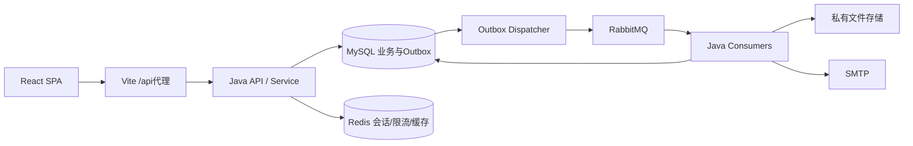

# 系统架构与技术选型

状态：完整本机应用；核对日期 2026-10-29。日常开发使用 IDEA 运行 Java 主类，前端通过 Vite 访问真实 API。

## 1. 技术基线

| 层 | 选型 | 约束与理由 |
| --- | --- | --- |
| Java | JDK21，编译release=21 | 构建与生产同代JDK；不以本机更高版本字节码发布 |
| 后端 | Spring Boot4.0.9 / Spring MVC | Java21处于其支持范围；单个应用承载业务与可开关后台消费者。[官方要求](https://docs.spring.io/spring-boot/4.0/system-requirements.html) |
| 持久层 | MyBatis-Plus3.5.18，boot4-starter | 用Boot4专用Starter，复杂SQL显式Mapper；不叠加JPA或第二套MyBatis Starter。[官方依赖](https://baomidou.com/getting-started/) |
| 数据库 | MySQL8.4 LTS、InnoDB、utf8mb4 | 业务库campus_radar；完整表字段见schema.sql。[字符集说明](https://dev.mysql.com/doc/refman/8.4/en/charset-server.html) |
| 缓存/会话 | Redis8.x + Spring Data Redis/Lettuce + Spring Session | Redis承担短期状态；MySQL保存业务真值。[会话配置](https://docs.spring.io/spring-session/reference/configuration/redis.html) |
| 队列 | RabbitMQ4.4.x + Spring AMQP | 后台邮件、订阅、导出恢复和擦除；不把普通CRUD异步化。[可靠性指南](https://www.rabbitmq.com/docs/reliability) |
| 认证 | Spring Security，会话Cookie + CSRF | 浏览器不持JWT，减少刷新令牌和撤销的额外逻辑 |
| 前端 | React19.2、TypeScript5.9、Vite8、React Router7 | BrowserRouter SPA；Node24；深链接由反代回退index.html。[Vite环境要求](https://vite.dev/guide/) |
| 视图与状态 | 原生CSS变量、Radix Dialog、React外部存储hook | 共享客户端与页面hook管理请求状态，按实际需要引入依赖 |
| 交互 | 原生表单与HTML拖拽、键盘阶段菜单、CSS/SVG图表、PDF.js | 当前以实际交互需求实现；PDF引擎动态加载，锁版本见package-lock |
| 接口合同 | OpenAPI3.1 JSON、openapi-typescript | 合同先行；Java DTO用record，前端类型由合同生成；不需要另一套运行时文档服务 |
| 构建与测试 | Maven Wrapper3.9、npm、JUnit5/MockMvc、Vitest/Playwright | BOM管理Spring家族，package-lock锁前端；集成测试使用真实MySQL/Redis/RabbitMQ |
| 本机运行 | IDEA Java主类 + Vite + Docker Compose依赖 | Compose保存本机依赖配置，数据保存在持久卷；后端默认启用dev |

4.0.9与3.5.18是本轮选定且官网可见的基线，不是“永远最新”的声明。依赖升级时核对兼容性并运行相关检查。Spring依赖通过Boot BOM管理，不手工混用其他大版本；Boot4默认Jackson3时统一使用Boot配置的JSON映射器，特别验证MyBatis JSON TypeHandler与Session序列化，不复制Jackson2示例。

## 2. 运行与数据流



同一个Java工程产出一个可执行jar。API、Dispatcher、Consumer均在同一进程，职责通过包隔离。MySQL事务是写入确认边界，Redis和RabbitMQ不参加本地数据库事务。

候选比较：模块化单体满足当前单产品；多服务会增加鉴权、部署与事务成本；全前端只能承载预览。因此选择单体后端和独立SPA，保留按模块切分的代码边界。

## 3. 模块与目录合同

代码在 frontend 和 backend；infra 保存本机依赖与反代参考配置。

```text
frontend/
  src/app/                 路由、Providers、ErrorBoundary
  src/features/            public/jobs/workspace/extended/account/admin
  src/components/          共享UI；真实API壳层在app/api-shell.tsx
  src/api/                 generated.ts与共享真实API客户端
  src/styles/              global.css；各业务CSS跟随模块
  src/lib/                 验收模型、浏览器记录、主题；*.test.ts
  e2e/                     Playwright页面与交互验收
backend/
  pom.xml、mvnw
  src/main/java/com/campusradar/
    CampusRadarApplication.java
    common/                错误、请求编号、时钟、JSON等小型基础工具
    security/              会话、CSRF、主体、角色和归属校验
    account/               资料、邮箱、备份、注销
    catalog/               公司、岗位、来源、检索
    application/           看板、版本、排序、事件
    knowledge/             面经、题目、宝典和私有进度
    interview/             日程、轮次、复盘、模拟练习
    resume/                文件、简历版本、规则诊断
    growth/                规划、Offer、薪资、统计
    social/                社区、内推、房间、邀请、情报
    notification/          站内通知、订阅、邮件投递
    moderation/            审核、举报、审计
    task/                  Outbox、Inbox、任务状态、消费者
  src/main/resources/      application.yml、application-dev.yml
  src/test/                同模块规则/集成测试
infra/                     compose.yml、本机依赖和反代参考
docs/contracts/schema.sql  全新空库首次手动初始化的完整SQL
```

每个业务包内部采用controller/service/mapper/entity/dto，仅有实际需要时再拆子包。Controller处理HTTP，Service做授权和事务，Mapper只执行带作用域的查询，DTO隔离持久化实体。跨模块经Service或只读接口调用，不从Controller直接拼表。

## 4. 关键决策

- 使用UUID字符串，Java UUID生成；数据库CHAR(36) ASCII二进制排序；API不传大整数ID，避免JS精度问题。
- MyBatis-Plus只用于CRUD、分页、版本字段；@TableId(INPUT)、@Version与更新时间填充统一配置。自定义SQL必须显式owner和version条件、检查影响行数。[乐观锁限制](https://baomidou.com/plugins/optimistic-locker/)
- 数据库连接UTC，Instant映射DATETIME(3)，LocalDate映射DATE。API为ISO8601，使用独立注入Clock测试截止和计时。
- 不使用RLS等旧库特性；私有表查询参数来自已认证主体，复合外键防跨账号引用。客户端userId字段不能决定归属。
- 公共检索采用MySQL ngram全文索引和业务条件；q至少2字符，空q为默认列表。全文查找只做候选，权限/发布状态在SQL内过滤；没有向量与独立搜索集群。[ngram官方说明](https://dev.mysql.com/doc/refman/8.4/en/fulltext-search-ngram.html)
- 私有附件经Java鉴权读写，首期本地持久目录；FileStorage接口固定为put/open/delete。多副本需共享存储后再扩容，不引入首期对象存储运维。
- 不设可任意写整块JSON的workspace接口；每个实体有明确DTO、表、归属和版本。JSON只保存小型偏好、报告、快照和权重。
- 普通保存同步返回成功；仅邮件、订阅扫描、导出/恢复、账号/文件擦除使用任务。没有外部AI或Python运行时。

## 5. 当前前端与生产边界

默认入口是api-routes，39路由请求同源JavaAPI。账号与业务记录由服务端持久化，私有文件由鉴权下载接口读取；API失败显示错误，不回退样例。演示业务仅在显式VITE_DEMO_MODE=true开发入口加载，默认构建不导入。OpenAPI生成类型和控制器映射均有检查，实际HTTP、依赖和浏览器验证仍以HANDOFF记录为准。

后端通用设置在 `application.yml`，本机连接与 `campus` 业务属性在 `application-dev.yml`。默认启用 `dev`，Java 启动不自动初始化数据库；现有业务库直接使用，新空库才手动执行完整 SQL。详见 [开发指南](08-development.md)。
