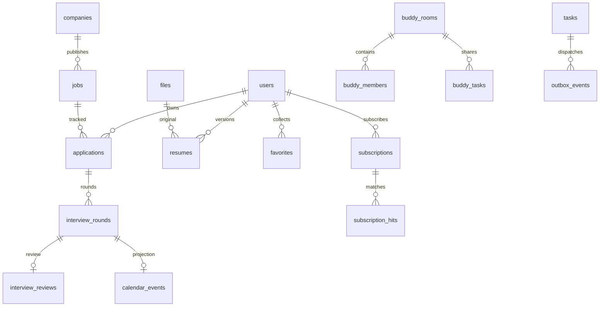

# 数据库设计

[完整建表 SQL](contracts/schema.sql) 包含 49 张业务表的字段、索引、外键和 CHECK。已有业务库直接使用；仅在首次创建全新空库时，用 root 手动执行一次该文件。Java 启动不自动建表，不能对现有业务库重复执行初始化 SQL。本机连接设置见 [开发指南](08-development.md)。

## 1. 通用规则

- MySQL8.4、InnoDB、utf8mb4_0900_ai_ci；实体ID使用CHAR(36) CHARACTER SET ascii COLLATE ascii_bin，Java UUID，不使用雪花数值外传。纯关系job_cities、job_graduation_years、post_likes使用自然复合主键，无独立UUID、version、updated_at；created_at只记录关系建立时间。城市/届别集合变更递增jobs.version；点赞按复合键增删，不与正文编辑共用乐观版本。
- created_at/updated_at为UTC DATETIME(3)，持久化模型用Instant；日期使用DATE/LocalDate。排序DECIMAL(30,10)对外是字符串。
- 可编辑实体的version默认1；纯关系不套用此字段。所有可编辑实体条件更新；首次创建单条进度的请求version=0，创建后返回1。不存在的本人进度GET返回404，前端再显式创建。
- 邮箱NFKC归一化、trim和小写后唯一；displayName可重复。密码只保存Argon2id哈希。会话放Redis，数据库auth_version控制账号级撤销。
- 金额整数分，范围0–10^12，空值表示未知；金额计算用BigDecimal，客户端不自行从缺失项推断年薪。
- JSON字段只保存经DTO校验的偏好、报告、权重、快照。集合关系和高频筛选使用独立表，不能把全账号状态塞进一个JSON。salary/report尚无结果时为SQL NULL；数组为空时存[]，对象为空时按明确schema存，不混用字符串"null"。
- 公共实体以状态下架；个人投递用archived_at；其它私人实体按生命周期物理清理。不统一套@TableLogic，避免逻辑删除破坏唯一约束和恢复。
- 外键默认RESTRICT；少数纯从表CASCADE、公开内容作者SET NULL。所有跨私人实体关联使用(user_id,id)复合唯一键/外键，公开逻辑目标另在服务层按类型校验。

## 2. 关系与完整性

图中的Task→Outbox是逻辑aggregate_id关系，事件也可引用其它业务资源，不设错误的全局任务外键。favorites和content_reports为类型化目标引用，数据库无法对多种目标加单一外键；Service校验类型/发布范围/目标存在，目标下架时保留收藏但显示unavailable。

问题关联章节使用questions.chapter_id；公司题库关联用question_companies，必须有evidence_note和observed_at。公司风格从已发布面经/题目统计，不能凭空构造公司评分。

## 3. MyBatis-Plus与事务

配置PaginationInnerInterceptor(DbType.MYSQL)、OptimisticLockerInnerInterceptor与防全表更新拦截器；自定义SQL显式写where user_id和version，不假设插件会替所有Mapper补条件。DTO禁止暴露Entity，排序字段用后端枚举映射，所有值用绑定参数。

典型更新逻辑：先在本人作用域查询，不存在404；执行UPDATE ... SET ...,version=version+1 WHERE id=? AND user_id=? AND version=?；影响0行返回409。create/patch/delete均由Service事务控制；重试数据库死锁最多2次，仅对已具有幂等语义的完整事务执行。

所有私人业务写入在事务开始锁定users行，检查ACTIVE和data_operation=IDLE；备份覆盖的业务实体（资料偏好、投递、简历及其原件、日程、学习、练习、规划、Offer、收藏、订阅、通知）变更完成时data_revision+1。任务、Outbox/Inbox、幂等记录、备份文件上传、预览创建和apply受理等操作元数据不递增此版本，避免预览自身造成必然冲突；恢复完成时统一递增一次。事务内仅处理数据库，不执行SMTP、文件解析或长时间网络操作。应用锁顺序统一：users → 房间（涉及组队时）→ 目标记录 → 关系表 → Outbox。看板复用已取得的users行锁，不另建锁表。

### 看板

按已认证主体锁本人users行，读取users.board_version并映射为API boardVersion，校验它与目标卡version；beforeId指放在该卡前，afterId指放在该卡后，均须在目标列且属于本人；两者同传须相邻；均为空放列尾。公司泳道只是显示分组，排序仍按完整stage列保存，UI明确提示。

DECIMAL在邻居间取中值；间隔不足时整列事务重排。重排涉及的卡version递增，users.board_version在同一看板变更事务中递增一次；事件记录旧邻居及排序。移动成功后使前端看板查询失效并重取，不只替换被拖动的单卡。撤销需最新未撤销操作、10分钟窗口、相同当前版本与可恢复的邻居关系，否则409。

board_version与users.version、data_revision职责不同：前者只保护看板卡片集合、阶段与排序；users.version保护资料编辑；data_revision用于恢复预览冲突。新增投递、移动、撤销、归档/恢复、清空及恢复替换投递都使board_version递增一次，编辑资料或卡片笔记不递增。恢复不得从备份覆盖board_version，应在现有值上递增，避免旧客户端版本重新变得有效。每条卡片自身仍有version。由于所有私人写入已锁users，单独的application_boards既不增加并发能力，也不承载独立生命周期，因此删除该表。

### 评论与纯关系

面经与社区评论具有相同正文、作者、父节点和审核生命周期，统一为comments。experience_id与post_id由CHECK约束恰有一个非NULL，两列各自有实际外键；不用无法加外键的通用target_id替代。UNIQUE(experience_id,id)、UNIQUE(post_id,id)以及对应(topic_id,parent_id)自引用外键保证回复与父节点处在同一主题，顶层评论parent_id为空。MySQL对含NULL的复合外键跳过校验，因此只有当前主题的那组外键生效；XOR CHECK保证始终有一组有效。相关外键省略ON DELETE/UPDATE，使用默认RESTRICT，不在CHECK涉及列配置级联动作；作者外键仍可SET NULL。依据[MySQL复合外键NULL语义](https://dev.mysql.com/doc/refman/8.4/en/ansi-diff-foreign-keys.html)与[CHECK约束限制](https://dev.mysql.com/doc/refman/8.4/en/create-table-check-constraints.html)；实际检查记录见 [最新交接](HANDOFF.md)。

评论的主题与parent_id创建后不可修改；新增回复先校验父节点存在且可读，数据库禁止自指，服务层限制回复深度。父节点只能引用已存在评论并且不可改父关系，以此避免后续构造循环；删除使用审核状态隐藏，保留回复引用。面经/社区接口继续使用各自路径，内部映射同一comments表。posts 与 comments 已包含在完整结构中。

job_cities、job_graduation_years和post_likes没有独立编辑或版本生命周期，分别以(job_id,city)、(job_id,graduation_year)、(post_id,user_id)为主键。添加与取消使用自然键幂等，城市/届别筛选保留反向索引；点赞不暴露独立资源ID。question_companies含证据与观测时间，buddy_members含角色与成员资格，保留可编辑实体语义，不能仅因字段里有两条外键便一律压成无状态关系。

### 默认简历与日程

默认简历通过生成列default_owner和唯一索引保证一个账号最多一条；切换默认时锁users，先清旧标记再设新标记。新增简历sequence在同一用户锁下分配，避免并发重复。

round→calendar为同事务投影：创建/编辑轮次更新唯一round_id日程；轮次无开始时间则没有日程。编辑轮次关联日程经同一Service同步轮次；删除关联日程表示将轮次日程清空，保留轮次，不允许两个来源产生矛盾事实。服务端同时校验round.application_id等于事件关联applicationId，录音文件purpose=RECORDING且归属本人。删除轮次前清理其复盘和日程，录音走异步擦除。

### 备份、恢复与删除

users.data_revision随所有私人写入递增。恢复预览保存此版本，apply锁users后再次比对；通过即设data_operation=IMPORTING以冻结本人私人写入，仍允许本人读取任务；返回受理任务。清空任务使用RESETTING，终态复原IDLE。worker校验备份签名、同账号同环境、schemaVersion、外键、文件清单、容量后先将文件放staging，再用短事务替换私人记录与引用；内部恢复Service只能持当前任务lease_token在IMPORTING状态写入，普通业务仍被拒绝；失败保留旧记录，staging后台清理，不能产生指向不存在文件的正式引用。data_operation在终态恢复IDLE，进程中断通过任务租约回收，不永久锁账号。

导出对数据库使用一致性快照，文件列表以快照固定；清理器对导出引用的文件保留到任务结束。ZIP含manifest.json、私有实体JSON与可选原件；不导出密码、会话、身份令牌、角色、邮箱验证状态、其它账号数据或后台任务；HMAC-SHA256签名，7天过期。导入只恢复本账号私人数据，不重新发布面经/社区，不提升角色，不复制待办消息。

彻底注销受理后立即DELETING与auth_version+1；清理私有从表、本人内推申请、提供者资源、成员关系、通知/邮件与附件；关闭并删除本人房间及邀请/成员/任务从表；保留已发布公开内容时作者置NULL。先清users.avatar_file_id再删文件，避免循环外键；完成后删除身份记录。任务与审计去除用户可识别内容并保留最小错误信息供运维重试。备份按保留期滚动清除，不承诺已下载的用户副本被远程删除。

## 4. 检索与索引

jobs按publication_status/status/published_at/id、deadline_at/id与company_id索引；job_cities(city,job_id)和job_graduation_years(graduation_year,job_id)负责筛选。ngram_token_size=2，全量全文索引配置一致；修改分词参数需要重建索引。所有公开查询同时核对sources.enabled（岗位）和内容发布状态；缓存命中也不能绕过这一步。q为空不走全文，单字符q返回422 Q_TOO_SHORT，避免退化为无界LIKE扫描。

公共查询SQL始终带PUBLISHED；关键词做参数绑定，不把用户输入当SQL列名或布尔全文表达式执行。分页page默认1、size默认20最大100，page最多500；深页提示缩小筛选。排序相同用ID打破平局，动态更新可能造成跨页重复，客户端按ID去重；首期不承诺跨请求快照一致。

## 5. 表目录

字段全文以 `schema.sql` 为准，下表说明当前完整结构的职责与主要业务字段。

| 表 | 职责 | 主要业务字段 |
| --- | --- | --- |
| `users` | 身份与资料 | `email`, `password_hash`, `display_name`, `role`, `status`, `auth_version`, `avatar_file_id`, `board_version`, `data_revision`, `data_operation`, `school`, `education`, `buddy_discoverable`, `graduation_year`, `preferences`, `theme`, `timezone`, `onboarding_step`, `provider_verified`, `provider_verified_until`, `email_verified_at` |
| `companies` | 公司公开资料 | `slug`, `name`, `logo_url`, `industry`, `size_band`, `cities`, `tags`, `description_md`, `verified_at` |
| `sources` | 人工内容来源登记 | `name`, `base_url`, `content_mode`, `permission_note`, `enabled`, `verified_at` |
| `chapters` | 求职宝典章节 | `parent_id`, `slug`, `title`, `direction`, `sort_order`, `body_md`, `content_version`, `status` |
| `outbox_events` | 业务事务内登记事件 | `event_type`, `aggregate_id`, `routing_key`, `payload`, `state`, `attempt`, `available_at`, `lease_token`, `lease_until`, `published_at` |
| `consumer_inbox` | 每处理器每事件的幂等和租约 | `consumer`, `event_id`, `state`, `lease_token`, `lease_until` |
| `auth_tokens` | 密码重置令牌（邮箱验证令牌仅为已停用历史记录） | `user_id`, `purpose`, `token_hash`, `expires_at`, `consumed_at` |
| `jobs` | 公开岗位 | `company_id`, `source_id`, `title`, `role`, `education`, `recruitment_type`, `skills`, `description_md`, `search_text`, `canonical_url`, `canonical_url_hash`, `salary`, `deadline_at`, `deadline_date`, `deadline_precision`, `source_timezone`, `status`, `publication_status`, `published_at`, `collected_at` |
| `files` | 私有附件元数据 | `user_id`, `purpose`, `original_name`, `storage_key`, `mime_type`, `size_bytes`, `sha256`, `state`, `expires_at` |
| `experiences` | 面经与审核状态 | `author_id`, `company_id`, `title`, `summary`, `body_md`, `role`, `round_type`, `occurred_on`, `tags`, `content_mode`, `source_url`, `license_note`, `status`, `published_at` |
| `questions` | 公共题库 | `title`, `chapter_id`, `prompt_md`, `answer_md`, `role`, `difficulty`, `tags`, `status` |
| `chapter_progress` | 本人笔记和学习进度 | `user_id`, `chapter_id`, `completed`, `note`, `chapter_version` |
| `favorites` | 收藏；目标为类型化逻辑外键 | `user_id`, `target_type`, `target_id` |
| `mock_sessions` | 题库练习计时 | `user_id`, `role`, `company_id`, `duration_seconds`, `remaining_seconds`, `state`, `timer_started_at`, `report` |
| `plan_tasks` | 个人任务及里程碑 | `user_id`, `title`, `status`, `due_at`, `notes`, `milestone`, `sort_order`, `generation_key` |
| `offer_comparisons` | 本人唯一比较配置 | `user_id`, `offer_ids`, `weights` |
| `salary_reports` | 匿名展示的薪资样本 | `author_id`, `company_id`, `role`, `city`, `year`, `base_monthly_minor`, `salary_months`, `bonus_minor`, `source_note`, `verification`, `status` |
| `subscriptions` | 岗位订阅配置 | `user_id`, `name`, `conditions`, `in_app`, `email_enabled`, `enabled`, `last_scanned_at` |
| `notifications` | 站内通知 | `user_id`, `type`, `title`, `body`, `target_path`, `read_at`, `dedup_key` |
| `mail_deliveries` | 邮件投递，外部发送无法保证恰好一次 | `user_id`, `recipient`, `template`, `encrypted_payload`, `dedup_key`, `state`, `attempt`, `provider_message_id`, `expires_at` |
| `posts` | 公开社区动态 | `author_id`, `body_md`, `tags`, `status`, `published_at` |
| `buddy_rooms` | 组队房间 | `owner_id`, `name`, `description`, `visibility`, `capacity`, `state` |
| `radar_signals` | 有时间与来源的公司信号 | `company_id`, `title`, `body`, `kind`, `source_url`, `occurred_at`, `verified_at`, `confidence`, `status` |
| `content_reports` | 内容举报与处置 | `user_id`, `target_type`, `target_id`, `reason`, `state`, `reviewer_id`, `decision_note` |
| `audit_logs` | 追加式管理审计 | `actor_id`, `action`, `target_type`, `target_id`, `reason`, `request_id`, `change_summary` |
| `idempotency_records` | HTTP写入重放 | `user_id`, `method`, `route_hash`, `idem_key`, `request_hash`, `http_status`, `response_body`, `expires_at` |
| `job_cities` | 岗位多地点关系 | `job_id`, `city` |
| `job_graduation_years` | 岗位届别关系 | `job_id`, `graduation_year` |
| `resumes` | 简历版本 | `user_id`, `file_id`, `name`, `sequence`, `is_default`, `text_content`, `extraction_state` |
| `question_companies` | 题目与公司样本关系 | `question_id`, `company_id`, `evidence_note`, `observed_at` |
| `question_progress` | 本人掌握度与错题 | `user_id`, `question_id`, `mastery`, `is_wrong`, `note` |
| `mock_answers` | 题目和答案快照 | `user_id`, `session_id`, `question_id`, `sequence`, `prompt_snapshot`, `reference_snapshot`, `answer_text`, `self_score` |
| `subscription_hits` | 岗位版本命中去重 | `user_id`, `subscription_id`, `job_id`, `job_version`, `notification_id` |
| `referrals` | 已认证提供者的内推 | `provider_id`, `company_id`, `job_id`, `title`, `description`, `expires_at`, `status` |
| `comments` | 面经与社区共用评论及审核 | `experience_id`, `post_id`, `author_id`, `parent_id`, `body`, `status` |
| `post_likes` | 点赞关系 | `post_id`, `user_id` |
| `buddy_members` | 房间成员 | `room_id`, `user_id`, `role`, `joined_at` |
| `buddy_invitations` | 邀请状态与到期 | `room_id`, `inviter_id`, `invitee_id`, `state`, `expires_at` |
| `buddy_tasks` | 房间共享题目任务 | `room_id`, `title`, `question_id`, `due_at` |
| `tasks` | 后台任务状态和租约 | `user_id`, `type`, `state`, `payload`, `result_file_id`, `progress`, `attempt`, `max_attempts`, `dedup_key`, `next_attempt_at`, `lease_token`, `lease_until`, `error_code` |
| `import_previews` | 备份恢复校验快照 | `user_id`, `backup_file_id`, `data_revision`, `state`, `manifest`, `expires_at` |
| `applications` | 投递与归档 | `user_id`, `job_id`, `resume_id`, `stage`, `sort_key`, `notes`, `applied_at`, `closed_reason`, `closed_at`, `archived_at` |
| `referral_requests` | 仅申请双方可读 | `referral_id`, `applicant_id`, `message`, `status`, `reply`, `consent_at` |
| `buddy_task_progress` | 成员自己的任务完成状态 | `room_id`, `task_id`, `user_id`, `completed` |
| `application_stage_events` | 不可变投递事件 | `user_id`, `application_id`, `operation_id`, `from_stage`, `to_stage`, `old_sort_key`, `new_sort_key`, `old_before_id`, `old_after_id`, `result_version`, `occurred_at`, `undone` |
| `interview_rounds` | 面试轮次 | `user_id`, `application_id`, `title`, `round_type`, `sequence`, `mode`, `status`, `starts_at`, `ends_at`, `timezone`, `location`, `meeting_url` |
| `offers` | 本人Offer | `user_id`, `application_id`, `company_name`, `title`, `city`, `base_monthly_minor`, `salary_months`, `bonus_minor`, `equity_note`, `benefits`, `expires_at`, `status`, `scores` |
| `calendar_events` | 日程；轮次日程同步投影 | `user_id`, `application_id`, `round_id`, `title`, `kind`, `starts_at`, `ends_at`, `timezone`, `location`, `meeting_url`, `notes`, `status` |
| `interview_reviews` | 本人轮次复盘 | `user_id`, `round_id`, `recording_file_id`, `transcript`, `notes`, `self_score` |

## 6. 精简依据与扩展边界

当前保留 49 张表：看板复用 users 的锁与版本，两类评论共用 comments。各业务模块复用 users、files、tasks 与审计等基础能力。

| 保留边界 | 不合并的原因 | 后续扩展入口 |
| --- | --- | --- |
| users / offer_comparisons | 比较配置有独立版本和编辑冲突；与身份资料无同一修改生命周期 | 用户一份比较配置；offer_ids是经过本人归属与数量校验的有序选择快照，weights是固定维度对象。若出现多套命名方案，再调整该模块，不塞入users.preferences |
| tasks / outbox_events / consumer_inbox / mail_deliveries | 任务执行、消息投递、每消费者去重、外部邮件发送的状态、租约、重试与保留期限不同；一条任务可能产生多次attempt事件，同一事件可有多个消费者 | 新耗时任务新增type、载荷DTO与路由；新增消费者增加consumer值；新邮件模板增加template，均不复制基础表。事件不强行外键绑定某一种业务实体 |
| applications / application_stage_events | 当前卡片事实与不可变阶段历史分别服务编辑和撤销/统计 | 新阶段先更新受控枚举及合同；统计由历史派生，不提前建统计快照表 |
| interview_rounds / calendar_events | 轮次事实和日程视图职责不同；日程还含用户独立创建的非面试事项 | 轮次通过唯一round_id同事务投影，继续沿用这一同步入口；不另造轮次日历关联表 |
| comments / favorites / content_reports | 评论需要真实主题外键；收藏与举报引用有限的跨模块目标，目标类型由DTO和Service白名单校验 | 新增第三种评论主题时显式增加可空外键、XOR约束与同主题父键；仅实际出现该需求才调整结构，不预建通用内容主表 |
| job_cities / job_graduation_years / question_companies | 多值筛选和携带证据的关系各有查询/更新语义，不能塞成难以索引的JSON数组 | 新高频筛选维度在需求与查询明确后增加对应列或关系；技能与标签仍为有schema的小集合，实际需关系检索时再拆 |

扩展默认沿用模块 Service、DTO 和受控类型枚举，同步完整 SQL 结构说明；对已有数据库的结构调整应明确列出变更及数据影响。仅对确有独立生命周期、基数或权限边界的记录建新表；不预留租户、插件、工作流、任意键值属性或通用多态实体表。小型偏好、固定权重、报告和不可变快照可用受校验JSON，实体、成员、命中去重和高频查询关系使用列/约束/关系表。新增维度不改变用户身份、私人归属、消息幂等和数据真实性的既有边界。
