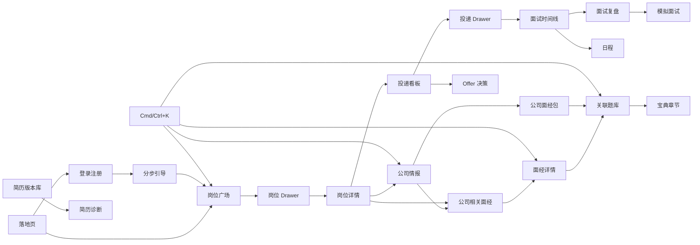

# 02 信息架构 IA 轻量初稿

版本：0.1。阶段指生产能力；全部路由先提供清晰标记的 mock 预览。MVP/V2/V3 的页面均独立存在，不用一个万能页面根据路径切换所有内容。

## 页面地图：直接对应 app/

Next.js 路由组不改变 URL；动态参数用 `[id]`、`[company]`，不使用字面量 `:id`。

```text
app/
├── (marketing)/page.tsx                         /                         MVP
├── (auth)/login/page.tsx                        /login                    MVP
├── (auth)/register/page.tsx                     /register                 MVP
├── (auth)/auth/callback/route.ts                /auth/callback            MVP
├── (onboarding)/onboarding/page.tsx             /onboarding               MVP基础 / V2解析
└── (workspace)/
    ├── jobs/page.tsx                           /jobs                     MVP
    ├── jobs/[id]/page.tsx                      /jobs/:id                 MVP / V2匹配
    ├── company/[id]/page.tsx                   /company/:id              MVP基础 / V3完整
    ├── subscriptions/page.tsx                  /subscriptions            V2
    ├── referral/page.tsx                       /referral                 V2
    ├── pipeline/page.tsx                       /pipeline                 MVP
    ├── calendar/page.tsx                       /calendar                 V2
    ├── analytics/page.tsx                      /analytics                V2
    ├── resumes/page.tsx                        /resumes                  V2
    ├── interview/[id]/timeline/page.tsx        /interview/:id/timeline    V2
    ├── interview/[id]/review/page.tsx          /interview/:id/review      V2
    ├── mock/page.tsx                           /mock                     V3
    ├── style/[company]/page.tsx                /style/:company           V2
    ├── experiences/page.tsx                    /experiences              MVP
    ├── experiences/[id]/page.tsx               /experiences/:id          MVP / V2总结发布评论
    ├── questions/page.tsx                      /questions                V2
    ├── handbook/page.tsx                       /handbook                 MVP
    ├── pack/[company]/page.tsx                 /pack/:company            V2
    ├── resume-check/page.tsx                   /resume-check             V3
    ├── planner/page.tsx                        /planner                  V2
    ├── salary/page.tsx                         /salary                   V2
    ├── offer-compare/page.tsx                  /offer-compare            V3
    ├── community/page.tsx                      /community                V3
    ├── buddy/page.tsx                          /buddy                    V3
    ├── radar/page.tsx                          /radar                    V3
    ├── me/page.tsx                             /me                       MVP基础 / V3成就
    ├── favorites/page.tsx                      /favorites                MVP基础 / V2题目
    ├── notifications/page.tsx                  /notifications            V2
    └── settings/page.tsx                       /settings                 MVP基础 / V2渠道
```

## 全局导航与页面职责

| 分组 | 主入口 | 次级入口/详情关系 |
| --- | --- | --- |
| 发现 Discover | 岗位广场、订阅、内推 | 公司从岗位、搜索、收藏进入 |
| 投递 Pipeline | 投递看板、日程、统计、简历库 | 面试时间线/复盘从投递与日程进入 |
| 面试 Interview | AI 模拟面试 | 公司风格从公司、面试包和搜索进入 |
| 知识 Knowledge | 面经、题库、宝典 | 面经详情/公司面经包从上下文进入 |
| 成长 Growth | 简历诊断、求职规划、薪资、Offer 决策 | 对应简历/投递/公司相互关联 |
| 社区 Community | 动态、同路人、情报雷达 | 帖子、组队房间先用详情 Drawer |
| 我的 Me | 个人主页、收藏、通知、设置 | 底部用户菜单；与顶部铃铛/头像一致 |

桌面工作台左侧 248px 固定侧栏，可收至 72px；顶栏 72px，含全局搜索、演示/数据更新时间、主题、通知、用户。MVP 生产只呈现已实现导航，预览模式展示完整导航并标阶段。无需把所有公司/面试详情永久放入侧栏。

## 页面跳转关系



图中后续能力遵循阶段门控。`/interview/[id]` 中的 id 统一指 Application ID，时间线展示其 InterviewRound 集合；review 用 `?round=roundId` 定位一轮，缺省选最近完成轮次。`[company]` 统一为公司 slug，由服务层解析，不混用名称和 UUID。

## 深链接与状态

- 岗位 URL：`/jobs?q=前端&city=上海&role=frontend&view=table&sort=deadline`；筛选与排序为 URL 状态，视图可同时记个人偏好。
- Drawer：`?preview=job:<uuid>` / `experience:<uuid>` / `question:<uuid>`，关闭仅移除 preview；刷新可恢复，后退先关闭；“完整详情”跳到独立路由。题目详情使用 `/questions?question=<uuid>` 深链接，不新增未要求的路由。
- 宝典：`/handbook?chapter=<slug>#section`，目录定位、滚动与分享一致。
- 公司：`/company/<uuid>?tab=jobs`；基础版只开放 overview/jobs，其他标签在预览模式展示。
- 收藏：`/favorites?type=job`；登录回跳只接受站内路径，避免开放重定向。
- Cmd/Ctrl+K：支持输入、键盘上下/Enter、ESC、分类；MVP 搜岗位/公司/面经/宝典，V2 添加题库；预览模式可搜所有 mock 类型。

## 页面内容编排

- 岗位：顶部标题/总量/更新标记，下方 240px 筛选 + 主列表；Drawer 560px。详情为 JD 主栏 + 匹配/公司侧栏。
- 看板：顶部 4 张统计卡、视图/筛选工具栏、8 列横向滚动。公司泳道可折叠，空列保留落点。
- 面经：筛选与搜索、内容流、热门公司侧栏；详情为目录/正文/摘要辅助栏。AI 摘要尚未生成时绝不显示伪结果。
- 宝典：目录树 + 阅读正文 + 可收起的笔记，移动端改为两张底部面板。
- 落地页：数据 Hero → 有来源的统计条 → 功能分区 → 真实构建后的截图视差 → 明确授权或演示标记的 Offer 墙 → FAQ；未获得真实统计前整体标“产品演示”。
- 独立页面的内容组件不复用一个“大仪表盘模板”；共享的是容器、工具栏、卡片和交互规则。

## 响应式与权限

- ≥1280px：完整侧栏、12 列、内容最大 1280px；≥1024 且 <1280：72px 侧栏，次级侧栏折叠。
- 768–1023px：抽屉导航、8 列，右侧辅助区以弹层呈现。
- <768px：4 列；底部 Tab 为岗位/投递/知识/我的；“我的”内有完整导航；列表优先卡片，筛选 Sheet，Drawer 改全屏。
- 表格可在自身容器滚动；看板横向滚动并提供阶段选择器；不让整个页面溢出。
- 公共读取：岗位、公司公开信息、已发布面经、宝典。私有操作：登录后收藏、看板、笔记及所有个人数据。公共页面使用工作台外观但匿名用户仍能浏览。
- 未登录访问私有页进入登录并保留 returnTo；不存在资源给 404；无权访问私人资源也返回 404；失败页有重试与返回入口。
