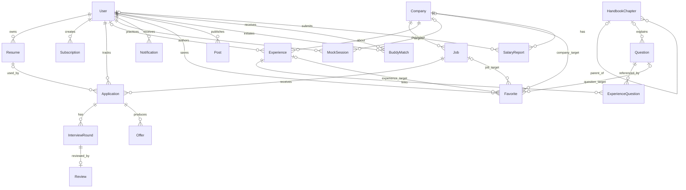

# 04 数据模型轻量初稿

版本：0.1。逻辑模型覆盖全产品，物理迁移随阶段推进；MVP 不提前建所有社区表。下文实体为 PascalCase，数据库使用 snake_case。

## 通用约定

- 主键 UUID；时间 `timestamptz`，UTC 保存；`created_at`、`updated_at` 默认存在。`?` 表示可空，其余必填；业务未提供的值使用 null，不用空串/0 冒充。
- 金额整数分，`currency` 使用 ISO 货币代码；薪资同时保存月/年/天口径，只有明确月数才年化。
- 用户私有实体有 `user_id` 外键与 RLS；公开内容有发布/来源/授权状态。外键默认 RESTRICT；用户私有从表在账户删除任务中按依赖清除。
- 面经与 JD 使用净化后的 Markdown/plain text；原始采集响应仅存受限对象存储并设保留期，不在业务 API 暴露。
- 阶段、筛选项、主题、API DTO、mock 种子都使用同一合同定义。User 对应身份服务用户，密码不存入业务 User。

## 核心 ER

图为全产品逻辑关系；Favorite 的四种目标必须恰好选一种，BuddyMatch 两端用户不得相同。ExperienceQuestion 是显式关联表，不用 JSON 数组代替可查询关系。

## 18 个指定实体字段

### 账户、简历、发现

| 实体 / 阶段 | 字段（除通用字段） | 约束与索引 |
| --- | --- | --- |
| User / MVP | id=身份服务 UUID；display_name:text；avatar_url:text?；graduation_year:int?；education:enum?；school:text?；onboarding_step:int；preferences:jsonb；theme:dark/light/system；timezone:text；status:active/deleting/disabled | 邮箱由身份服务维护，API 返回脱敏摘要；毕业年合理范围；不存明文密码 |
| Resume / V2 | user_id；version:int；name:text；storage_key:text；file_hash:text；mime_type:text；size_bytes:bigint；parsed:jsonb?；parse_status:task_state；embedding:vector(1536)?；embedding_model:text?；embedding_version:text?；content_hash:text；is_default:bool | unique(user_id,version)；每用户最多一个 default（部分唯一索引）；新版本不可覆盖旧文件；跨用户禁止按 hash 共享文件 |
| Company / MVP基础 | slug:text；name:text；logo_url:text?；industry:text?；size_band:text?；locations:text[]；tags:text[]；description:text；verified_at:timestamptz?；source_id:uuid?；intelligence:jsonb | unique(slug)；GIN tags；同名不同实体不强行合并 |
| Job / MVP | company_id；source_id；source_external_id:text?；canonical_url:text；title:text；role:text；cities:text[]；education:enum；recruitment_type:enum；graduation_years:int[]；skills:text[]；description_md:text；salary:jsonb?；deadline_at:timestamptz?；deadline_precision:enum；source_timezone:text；published_at:timestamptz；last_seen_at:timestamptz；verified_at:timestamptz；status:open/closed/unknown；content_hash:text；embedding:vector(1536)?；embedding_model:text?；embedding_version:text? | unique(source_id,canonical_url)；外部ID存在时 unique(source_id,source_external_id)；(status,published_at,id)、(deadline_at,id)、company_id；GIN skills/cities；中文 MVP 用 pg_trgm，短词受限前缀查询 |
| Subscription / V2 | user_id；name:text；conditions:jsonb；channels:jsonb；frequency:instant/daily；enabled:bool；last_matched_at:timestamptz? | 索引(user_id,enabled)；条件必须通过有版本 JSON Schema 校验 |

### 投递、面试、知识

| 实体 / 阶段 | 字段 | 约束与索引 |
| --- | --- | --- |
| Application / MVP | user_id；job_id；resume_id:uuid?（V2增列）；stage:application_stage；sort_key:numeric；version:int；notes:text；applied_at:timestamptz?；closed_at:timestamptz?；closed_reason:enum?；archived_at:timestamptz? | unique(user_id,job_id)；不物理删除投递，归档可恢复；(user_id,stage,sort_key,id)；version 乐观锁；resume_id 若存在须属本人 |
| InterviewRound / V2 | application_id；sequence:int；round_type:enum；title:text；scheduled_start:timestamptz?；scheduled_end:timestamptz?；timezone:text；status:scheduled/completed/cancelled；mode:online/offline/phone；location:text?；meeting_url:text? | unique(application_id,sequence)；end>start；仅 scheduled 事件参与冲突检测；展示按用户时区 |
| Review / V2 | interview_round_id；user_id；transcript:jsonb?；recording_storage_key:text?；manual_scores:jsonb；ai_report:jsonb?；task_id:uuid?；private_notes:text；consent_at:timestamptz? | unique(interview_round_id)；user_id 必须等于投递所有者；录音与转写私有；AI 报告含模型与来源段落 |
| Experience / MVP | company_id:uuid?；author_id:uuid?；source_id:uuid?；source_url:text?；title:text；summary:text；body_md:text?；role:text；round_type:enum；occurred_at:date?；tags:text[]；status:draft/pending/published/rejected；content_mode:licensed_full/user_original/excerpt_link；license_note:text；ai_summary:jsonb?；embedding:vector(1536)?；embedding_model:text?；embedding_version:text?；published_at:timestamptz? | excerpt_link 不要求全文；published 内容才公开；至少 author/source 之一存在；公司可未知；索引(company_id,role,published_at,id) |
| Question / V2 | title:text；prompt_md:text；answer_md:text；role:text；knowledge_tags:text[]；difficulty:easy/medium/hard；chapter_id:uuid?；source_count:int；embedding:vector(1536)?；embedding_model:text?；embedding_version:text?；status:draft/published | 不把个人掌握度放公共题目；频次统计保留样本时间窗口 |
| HandbookChapter / MVP | parent_id:uuid?；slug:text；title:text；direction:text；sort_order:int；body_md:text；content_version:int；status:draft/published | unique(slug)；禁止父子循环；(direction,parent_id,sort_order)；正文版本变化不静默覆盖笔记 |

### 成长、社区、个人

| 实体 / 阶段 | 字段 | 约束与索引 |
| --- | --- | --- |
| MockSession / V3 | user_id；job_id:uuid?；company_id:uuid?；configuration:jsonb；state:configuring/active/submitted/scoring/completed/failed；started_at:timestamptz?；finished_at:timestamptz?；report:jsonb?；task_id:uuid? | 答题单独 MockAnswer 表；服务端计时；状态转移检查；同一提交幂等 |
| Offer / V3 | user_id；application_id；version:int；title:text；currency:char(3)；base_monthly_minor:bigint?；salary_months:numeric?；bonus_minor:bigint?；equity:jsonb?；city:text；benefits:jsonb；deadline_at:timestamptz?；status:pending/accepted/rejected/expired；dimensions:jsonb | application.user_id=user_id；unique(application_id,version)；薪酬未知时不计算伪年包；股票折算独立假设 |
| Notification / V2 | user_id；type:job_hit/interview_reminder/system/social；title:text；body:text；target_path:text?；read_at:timestamptz?；dedup_key:text | unique(user_id,dedup_key)；(user_id,read_at,created_at,id)；外部渠道状态另表 |
| Favorite / MVP基础 | user_id；target_type:job/experience/question/company；job_id:uuid?；experience_id:uuid?；question_id:uuid?；company_id:uuid? | CHECK 恰好一个目标且与 type 一致；每目标部分唯一索引(user_id,target_fk)；question 在 V2 接口开通 |
| Post / V3 | user_id；body_md:text；tags:text[]；attachments:jsonb；visibility:public/team；status:pending/published/hidden/deleted | 团队可见内容需要 room_id:uuid?；点赞/评论/举报用关系表，不把计数当源数据 |
| BuddyMatch / V3 | requester_id；candidate_id；score:numeric；reasons:jsonb；status:suggested/requested/accepted/rejected/blocked；room_id:uuid? | requester!=candidate；无序用户对唯一；blocked 阻断后续推荐 |
| SalaryReport / V2 | company_id；user_id:uuid?；role:text；level:text；city:text；year:int；currency:char(3)；base_monthly_minor:bigint?；salary_months:numeric?；bonus_minor:bigint?；equity:jsonb?；verification:self_reported/verified；source_url:text?；sample_note:text | 公开展示匿名；聚合按公司/岗位/城市/年份/口径过滤；n<5 不画分位箱线图 |

## 支撑实体与关系

| 实体 | 关键字段 / 规则 | 阶段 |
| --- | --- | --- |
| AuthSession | user_id、token_hash、加密的 provider 凭据、expires_at、revoked_at；浏览器只持不透明会话 cookie | MVP |
| ApplicationStageEvent | application_id、from_stage?、to_stage、old_sort_key?、new_sort_key、actor_id、occurred_at、version、operation_id、old_neighbors:jsonb（beforeId/afterId）；同列移动也记录；撤销写新事件 | MVP |
| ChapterProgress | user_id、chapter_id、completed、note、chapter_version、version；unique(user_id,chapter_id) | MVP |
| Source | name、base_url、allowed_hosts、company_id?、robots_checked_at、permission_status:pending/approved/paused、terms_note、allowed_content_mode、rate_policy:jsonb、enabled；候选不能默认 approved，MVP 官方招聘源绑定公司 | MVP |
| CrawlRun | source_id、task_id、started_at、finished_at、status、counts:jsonb、error_code；记录变更/跳过/失败数 | MVP |
| Task | user_id?、type、state、payload:jsonb、result_ref:jsonb?、dedup_key、attempt、max_attempts、available_at、lease_owner?、lease_until?、lease_token?、progress、error_code?、expires_at? | MVP |
| IdempotencyRecord | actor_id、route、key、request_hash、status、response:jsonb、expires_at；同 key 不同载荷返回 409 | MVP |
| ExperienceQuestion / QuestionCompany | 联合主键；引用经验/题目/公司；来源证据、轮次、时间窗口 | V2 |
| QuestionProgress | user_id、question_id、mastery:unseen/learning/mastered、is_wrong、note、last_practiced_at；联合唯一 | V2 |
| ExperienceComment / Reaction | author_id、experience_id、parent_id?、body、moderation_status；reaction 联合唯一 | V2 |
| SubscriptionHit / NotificationDelivery | 订阅+岗位+内容版本去重；渠道/发送状态/重试次数；channel token 加密存放 | V2 |
| ReferralCode / ReferralRequest | company_id、job_id?、code、expires_at、source/owner_id；申请 user_id、状态、审核与隐私授权 | V2 |
| PlanMilestone / PlanTask | user_id、时间、规则来源、提醒；任务 todo/doing/done，与投递 stage 分开 | V2 |
| MockAnswer | mock_session_id、question_id?、question_snapshot、answer_text、recording_ref?、duration_ms、feedback:jsonb；sequence 唯一 | V3 |
| TeamRoom / TeamMember / RoomQuestion | 房间、owner、可见性、成员角色、共享题集；加入/退出撤销访问 | V3 |
| RadarSignal / PostComment / PostReaction / ContentReport | 情报来源/时间/置信度、社区互动、举报审核 | V3 |
| OfferComparison / Achievement / UserAchievement | 个人权重与标准化假设；成就定义、获取时间、去重 | V3 |
| MatchSnapshot | user_id、resume_id、job_id、input_hash、model_version、component_scores:jsonb、explanation:jsonb、created_at；输入变更失效 | V2 |

## 枚举：与看板严格一一对应

| application_stage | 中文列 | 状态色 |
| --- | --- | --- |
| PENDING | 待投 | 中性 |
| APPLIED | 已投 | 蓝 |
| ASSESSMENT | 笔试 | 蓝 |
| INTERVIEW_1 | 一面 | 紫 |
| INTERVIEW_2 | 二面 | 紫 |
| HR | HR 面 | 紫 |
| OFFER | Offer | 绿 |
| CLOSED | 结束 | 灰红；原因辅以文字 |

- stage 允许用户跳跃或回退，必须记录事件；不强制每家公司都经过笔试或两轮面试。
- `closed_reason = rejected | withdrawn | expired | accepted | other`，仅 CLOSED 非空；从 CLOSED 移出时清空 closed_at/closed_reason；进入 APPLIED 且 applied_at 为空时可由用户确认日期，不推断外链点击即投递。
- `round_type = assessment | technical | business | hr | final | other`；sequence 与看板列不是同一概念，三面/加面不会新增看板枚举。时间线轮次为事实，看板阶段为用户管理状态，不自动同步覆盖。
- `education = any | associate | bachelor | master | doctorate`；`recruitment_type = campus | internship`。
- `deadline_precision = exact | date | unknown`：date 用来源时区当日 23:59:59 转 UTC，并向用户标“当日截止”；unknown 时 deadline_at=null。
- `task_state = queued | running | succeeded | failed | cancelled`；重试是 running→queued，attempt 递增；无永久 running。
- `task_type` MVP 仅 CRAWL_JOBS、DATA_EXPORT、USER_ERASURE；V2 加 PARSE_RESUME、EMBED_CONTENT、MATCH_JOBS、SUMMARIZE_EXPERIENCE、TRANSCRIBE、REVIEW_INTERVIEW、SEND_NOTIFICATION；V3 加 SCORE_MOCK、DIAGNOSE_RESUME。

## JSONB 结构合同（均含 schemaVersion）

| 字段 | 结构摘要 |
| --- | --- |
| User.preferences | `{schemaVersion:1, roles:string[], cities:string[], industries:string[], recruitmentTypes:string[], graduationYear:number|null}` |
| Resume.parsed | `{schemaVersion:1, education:[], projects:[], employment:[], skills:string[], warnings:string[], fieldEvidence:[]}`；原始身份信息单独加密/最小化 |
| Job.salary | `{schemaVersion:1, currency:"CNY", period:"month"|"year"|"day", minMinor:number|null, maxMinor:number|null, months:number|null, negotiable:boolean}` |
| Company.intelligence | `{schemaVersion:1, styleWeights:[], sources:[], releaseTimeline:[], updatedAt:string}`；MVP 允许空结构，不能填假趋势 |
| Subscription.conditions | `{schemaVersion:1, operator:"and", rules:[{field:"city",op:"in",value:["上海"]}]}`；白名单 field/op，拒绝任意 SQL/代码 |
| Subscription.channels | `{schemaVersion:1, inApp:true, email:false, webhookConnectionId:null}`；不在条件中保存凭据 |
| Review.transcript | `{schemaVersion:1, segments:[{id,startMs,endMs,speaker:"interviewer"|"candidate"|"unknown",text}]}` |
| Review.ai_report | `{schemaVersion:1, model,promptVersion,rubricVersion,dimensions:[],strengths:[],improvements:[],evidenceSegmentIds:[],limitations:[]}` |
| Experience.ai_summary | `{schemaVersion:1, model,promptVersion,contentHash,focusAreas:[],questionIds:[],pitfalls:[],evidence:[],generatedAt}` |
| MockSession.configuration/report | 配置含 role/company/round/mode/language/timeLimit；报告含维度分、逐题反馈、证据、模型/rubric 版本；缺少依据的分数为 null |
| Offer.dimensions / OfferComparison | 0–100 的用户评分、指标单位/正负方向、权重、来源与缺失项；缺失项不按 0 分计算；总权重规范化 |
| Task.payload/result_ref | `{schemaVersion:1,...}` 按 type 独立校验；载荷仅存资源 ID/对象引用，不放完整简历或密钥；结果存引用与摘要，导出为限时签名 URL |

## 向量、检索、数据保留

V2 使用 `vector(1536)` 作为初始合同，实际模型必须支持这个输出维度；实施前确认供应商与维度。每条向量与 model/version/content_hash 绑定，禁止混用不同模型。改变维度需迁移新列/索引并重建，不在运行时任意改维度。

公开 Job/Experience/Question 与私有 Resume 分表；检索先做招聘类型/届别等硬过滤，返回语义相似度与规则解释，不把余弦相似度当录用概率。低数据量先精确向量查询，测量后再加 cosine HNSW，验证过滤后的召回率。[pgvector 官方说明](https://github.com/pgvector/pgvector)。

MVP 中文检索采用归一化词匹配、pg_trgm 和业务字段筛选，不假设 PostgreSQL 默认英文分词能处理中文。搜索结果按类型分别分页，私有信息只能从当前用户范围检索。

简历/录音私有存储桶，短时签名访问；录音默认 30 天后删除，可由用户提前删除；AI 原始响应最多保留 7 天用于排错，业务结果按资源生命周期保存；脱敏任务日志保留 30 天；备份保留 7 天，删除后备份随保留期滚动消除。保留期为产品初始政策，生产启用前明确展示给用户。
