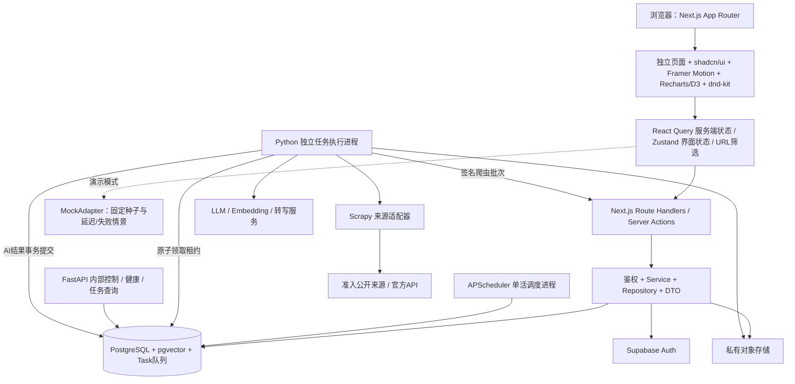

# 06 技术架构轻量初稿

版本：0.1。所有实现与部署都在用户确认方案之后；目前仅文档。

## 架构图与数据流



推荐模块化单体。MVP 无 Redis/Celery 依赖；需要扩容再替换 TaskRepository 实现，不改变浏览器任务协议。FastAPI 只做 worker 的内网控制面；持久化任务由独立 executor 处理，不依赖 FastAPI 进程内 BackgroundTasks 保证任务可靠性。[FastAPI 后台任务说明](https://fastapi.tiangolo.com/tutorial/background-tasks/)。

### 职责边界

- Next.js：公共页面 SSR/缓存，私有页面 no-store；每个 route/service 做鉴权；第三方内容净化；站内搜索、投递事务、任务入队。
- React Query：请求、缓存、mutation、分页、乐观更新；queryKey 带筛选/用户作用域，登出清空私有缓存。
- Zustand：侧栏、命令面板、主题、临时编辑缓冲；不重复保存 API 列表。URL 保存筛选、排序、tab、预览深链接。
- Repository：隔离 PG、Auth、Storage；浏览器 HttpAdapter 与 MockAdapter 遵循 OpenAPI DTO，服务端使用相同 domain/service。
- worker：爬虫、向量、AI、转写、推送、导出/清除；以资源 ID 和输入 hash 处理任务，完成前校验资源仍存在且版本一致。
- DB：实际采用 postgres.js 参数化 SQL 与显式 SQL migrations；pgvector/约束/索引同样由迁移管理；公开/私有分权。Python 用 psycopg 访问受限任务/结果表，不维护第二份 ORM schema。

### 持久化队列

Next.js 在业务事务内插入 Task，成功即202。Executor 用 `FOR UPDATE SKIP LOCKED` 领取 queued 且 available_at 到期的任务，提交事务后执行；租约默认60秒、每20秒心跳，长任务可续约。每次领取生成新的 lease_token，结果落库前必须比对；过期任务经回收器重新 queued。[PostgreSQL 队列式锁定说明](https://www.postgresql.org/docs/current/sql-select.html)。

系统是至少一次执行，靠 dedup_key、输入 hash、幂等批次及事务实现业务结果不重复；不是宣称模型只会调用一次。网络中断后未知状态的供应商请求可能重复计费，记录 provider_request_id，支持供应商幂等键时使用。最大重试3次，指数退避+抖动；永久权限/无效输入失败不重试；预算耗尽直接失败。用户删除资源会取消其未完成任务，旧租约不能写回。

APScheduler 只由一个进程调度，PG advisory lock 防重复 leader；有持久化下一次运行时间与去重键，重启 coalesce 错过的运行，不集中补发大量请求。FastAPI 以独立进程提供 /health/live、/health/ready、受服务鉴权的 /internal/tasks/{id} 和取消接口；不直接暴露公网，不在 MVP 浏览器 OpenAPI 中列入内部运维接口。

## 目录结构

以下均为拟建目录，不是当前已经存在的实现。

```text
campus-radar/
├── apps/
│   └── web/
│       ├── app/
│       │   ├── (marketing)/                 # /，专用轻量布局
│       │   ├── (auth)/                      # login/register/auth/callback
│       │   ├── (onboarding)/                # 引导独立布局
│       │   ├── (workspace)/                 # 全部工作台独立路由，见 IA
│       │   ├── api/v1/                      # MVP 业务 Route Handlers
│       │   ├── api/internal/v1/             # worker 签名同步
│       │   ├── layout.tsx
│       │   ├── loading.tsx
│       │   ├── error.tsx
│       │   ├── not-found.tsx
│       │   └── globals.css
│       ├── features/                       # jobs/pipeline/knowledge/interview/growth/community/account
│       │   └── jobs/                       # components/hooks/queries/contracts（每模块同结构）
│       ├── components/
│       │   ├── ui/                         # shadcn 源码
│       │   ├── shell/
│       │   ├── feedback/
│       │   └── charts/
│       ├── lib/
│       │   ├── api/                        # HttpAdapter/MockAdapter/错误处理
│       │   ├── mock/                       # 种子、演示时间基准、场景
│       │   ├── auth/
│       │   └── state/
│       ├── server/
│       │   ├── services/                   # 业务规则与授权
│       │   ├── repositories/               # DB/任务/存储抽象
│       │   └── db/                         # 参数化SQL repositories/client
│       ├── public/                         # 图标、插画、字体
│       ├── tests/                          # 集成与关键交互
│       ├── tailwind.config.ts              # 所有 token 与主题变量生成
│       ├── components.json
│       └── package.json
├── packages/contracts/                     # OpenAPI生成TS + 共享业务枚举/schema
├── workers/campus_worker/
│   ├── api/                                # FastAPI内部控制面
│   ├── scheduler/
│   ├── executor/                           # 租约/重试/幂等
│   ├── crawlers/                           # Scrapy spiders/pipelines/middlewares
│   ├── tasks/                              # AI/embedding/export/delete
│   ├── ai/                                 # provider接口、prompts、rubrics
│   ├── schemas/                            # OpenAPI派生/校验Python模型
│   └── tests/
├── database/migrations/                    # 唯一 schema 迁移来源
├── tests/e2e/
├── docs/campus-radar-v1/                    # 本轮六份文档
├── infrastructure/                         # 容器/本地PG/部署配置
├── pnpm-workspace.yaml
├── .env.example
└── README.md
```

页面文件只编排页面组件与必要服务端数据，避免所有功能都写进一个 Client Component。基础组件不过度抽象；领域边界对齐“发现/投递/知识/面试/成长/社区/账户”。

## 爬虫策略与来源准入

| 候选目标 | 拟采内容 | 初始频率 | 准入/降级 |
| --- | --- | --- | --- |
| 腾讯招聘公开校招岗位（careers.tencent.com） | 岗位标题/JD/地点/来源/DDL（若有） | 每6小时增量，夜间完整核对1次 | 候选，未审查授权与 robots 前不启用 |
| 字节跳动招聘公开校招岗位（jobs.bytedance.com） | 同上 | 每6小时增量，完整核对每天1次 | 同上；无许可则保留官方跳转/人工导入 |
| 面经与宝典 | 用户明确授权内容、原创或许可摘要 | MVP 种子导入；后续按授权更新 | 不默认抓第三方社区全文 |

以上是接入计划，不代表网站已授予采集或再分发许可；MVP 最多开通其中两个通过准入的岗位源。准入记录包括 robots 获取时间、使用条款、内容再分发范围、域名白名单、负责人和暂停开关。

Scrapy 启用 ROBOTSTXT_OBEY 与 AutoThrottle；每域初始并发1、请求间隔至少3秒、有正向抖动，目标平均不超过每分钟12请求，尊重 Retry-After。429/403/验证码立即退避或暂停来源，持续失败触发告警；这些值是初始上限，具体来源要求更严格时从严。[Scrapy AutoThrottle](https://docs.scrapy.org/en/latest/topics/autothrottle.html)。

代理池仅用于经授权的稳定出口/区域连通性，不通过换代理扩大配额；同域名共享总限流。请求去重指纹用于断点续采；HTTP header 保持稳定且诚实标识客户端，不伪装身份绕过封禁。不登录、不绕验证码、不采集私人联系方式。

流水线：公开源→解析→结构校验→来源内去重→公司实体匹配→变化 hash→签名批次→事务 upsert。MVP 为单公司官方招聘源，准入时同时建立 Company 并在 Source 配置中绑定 companyId；未知公司不让爬虫任意创建实体，进入人工归一化队列后再入库。跨来源相似岗位先打疑似重复标记，避免误合并不同批次。页面显示 publishedAt/verifiedAt/来源；超过24小时未验证标“可能有更新”，不能笼统称为实时。

## AI 调用与成本（V2/V3）

- Provider 接口隔离文本生成/embedding/转写，不绑定某个厂商；启用前确定模型、数据区域、保存政策与用户授权。
- 简历解析、面经总结、评分、改写都返回经 JSON Schema 校验的结构；格式重试最多1次且计入预算。来源文档视为数据，忽略其中的工具/系统指令；worker 默认无外部工具调用权限。
- 生成按 contentHash+model+promptVersion+rubricVersion 缓存；私有简历只在本人范围命中。公开内容可共享摘要缓存，用户资料不能跨用户缓存。
- 匹配先硬过滤，再 embedding，最后可解释评分；LLM 只用于需要解释的少量候选，不每次滚动列表都调用模型。
- 报告显示生成时间、证据和适用范围；录用概率、虚构面试轮次/薪资不生成。
- 初始预算策略：每用户每日解析3次、总结10次（优先公共缓存）、诊断2次、模拟面试2场；每场最多10题。文本任务输入最多12k token、输出最多2k；模拟整场总输入最多40k、输出最多6k，超限提示缩短材料，不静默截断关键内容。
- 文本超时90秒、解析120秒、整场模拟评分180秒，重试仍受总预算和任务超时限制；无凭据时仅在明确演示模式返回演示报告，生产返回服务未配置。
- 估算公式：文本成本 = 输入token/1e6×输入单价 + 输出token/1e6×输出单价；embedding = token/1e6×单价；转写 = 分钟×单价。月预算含重试、缓存命中率与峰值，价格来自启用时的供应商价表，不在此虚构当前费用。
- 初始平台 AI 上限设为每天人民币50元等值的计费预算，汇率/价格表带生效日期；入队预留最大预算，完成按实际用量结算，超限停止新增付费任务。预算由配置调整，不自动升级付费方案。

## 鉴权、数据访问与上传

Supabase Auth 负责验证邮箱与密码；站点 /auth/callback 校验 state/一次性 code，BFF 建立自有不透明 HttpOnly 会话。登录/刷新/登出集中在服务端，供应商 token 加密存 AuthSession，密钥不进浏览器。生产实现前核对 SDK/Next.js 版本对应 API。所有 Route Handlers 与 Server Actions 均视为外部入口进行权限检查。[Next.js 鉴权指南](https://nextjs.org/docs/app/guides/authentication)。

应用运行角色非 table owner，私有表启用 RLS；通过事务局部用户上下文执行，连接池归还前无会话残留。身份必须来自服务端会话，不能接受用户自报 UUID。worker 角色仅能领取任务、读取任务所需授权对象和写结果，不能任意读取用户表。RLS 是额外防线，不能用 service-role 全权限连接宣称已隔离。[PostgreSQL RLS](https://www.postgresql.org/docs/current/ddl-rowsecurity.html)。

V2 文件上传：申请限时签名→浏览器直传私有桶→服务端确认 hash/大小/MIME/魔数→扫描→任务入队；PDF/DOCX 上限10MB，解析在无宏/无任意网络的隔离环境。删除文件或撤销同意后取消相关任务。API 请求不携带完整文件，不等待 AI。

## Mock 与真数据切换

确认后构建期设置 NEXT_PUBLIC_DATA_MODE=mock|api，并在启动时校验环境。mock 固定种子、固定基准时间，通过配置演示0/300/1200ms延迟、超时/空/错误；所有指标与 Offer 墙有演示标记。对外公开的 mock 永不处理真实简历/录音/密码；“体验账户”不请求真实凭据。

UI 预览可用浏览器本地保存非敏感演示状态，提供“重置演示”；生产收藏/投递必须落服务器。MockAdapter 不导入服务端模块；生产 API 失败不得静默回退假数据。以 OpenAPI 做 DTO 合同检查，保证切换不改页面组件。

## 环境变量草案

| 变量 | 范围 | 用途 |
| --- | --- | --- |
| NEXT_PUBLIC_APP_URL / NEXT_PUBLIC_DATA_MODE | 可公开 | 站点地址 / mock或api |
| DATABASE_URL / DATABASE_DIRECT_URL | 服务端 | 运行连接池 / 迁移直连；分角色 |
| SUPABASE_URL / SUPABASE_PUBLISHABLE_KEY | 服务端配置；不含特权 | 身份服务 |
| SUPABASE_SERVICE_ROLE_KEY | 仅账户清除等受限服务 | 身份/存储管理；不用于所有业务查询 |
| AUTH_COOKIE_SECRET / AUTH_TOKEN_ENCRYPTION_KEY | 仅Web服务端 | 会话签名与供应商凭据加密 |
| STORAGE_BUCKET_PRIVATE | Web/worker | 私有文件与导出 |
| WORKER_DATABASE_URL / SCHEDULER_DATABASE_URL | 对应进程 | 最小权限数据库角色 |
| WORKER_HMAC_KEY / WORKER_HMAC_KEY_ID / WEB_INTERNAL_ORIGIN | Web/worker | 内部同步签名、轮换和目标站点 |
| LLM_BASE_URL / LLM_API_KEY / LLM_MODEL | 仅worker | 模型调用 |
| EMBEDDING_MODEL / EMBEDDING_DIMENSIONS | 仅worker | 初始维度1536，须与迁移一致 |
| TRANSCRIPTION_API_KEY / AI_PRICE_TABLE / AI_DAILY_BUDGET_CNY | 仅worker | 语音与预算（启用时配置） |
| CRAWL_ALLOWED_SOURCES / PROXY_POOL_URL | 仅worker | 允许来源/经授权代理，默认空 |
| LOG_LEVEL / OTEL_EXPORTER_OTLP_ENDPOINT / SENTRY_DSN | 服务端 | 脱敏日志与告警 |

所有真实值不写入仓库；.env.example 只有名称与说明。开发/预览/生产分离 DB、桶、会话密钥。公开环境变量不放数据库/模型/worker 密钥。

## 部署、监控与验证

- Vercel 部署 Next.js，Railway 部署 FastAPI/executor/scheduler 三进程，Supabase 提供 PG/Auth/Storage；地域尽量靠近并在启用前验证目标用户网络与数据区域要求，不能只按地图距离推断可用性。
- PG 迁移使用直连、Web 使用池化连接；每次发布先检查迁移向后兼容，再部署 Web/worker。不可逆迁移先快照、验证恢复；不由预览环境自动修改生产库。
- 指标：HTTP p95/错误率、DB慢查询、队列最老年龄/租约回收/失败率、来源成功率/最后成功时间/重复率、AI token/成本/超时、用户核心漏斗。日志用 requestId/taskId/sourceId 关联，不打印简历、录音、cookie 或完整模型提示。
- 初始告警：API 5xx 连续5分钟>2%；队列最老任务>10分钟；来源连续失败3次或24小时未成功；AI预算达80%预警/100%停发；阈值上线后根据基线调整。
- 验收：TypeScript检查、lint、生产build；合同与越权集成测试；worker租约/幂等/失败恢复测试；Playwright 核心路径、键盘操作与移动端；真实浏览器检查主题/溢出/console/hydration；部署后 smoke 与备份恢复演练。
- 当前文档只定义验收要求，没有声称 build、API、爬虫或性能已经通过。

## 参考边界

本方案引用官方文档确认能力与约束，版本补丁在开始编码时检查兼容矩阵并固定 lockfile。候选招聘站尚未进行访问规则审查，真实 AI 模型及价格尚未采购；二者不阻塞 mock UI 开发，但必须在对应真实能力开通前落实。
